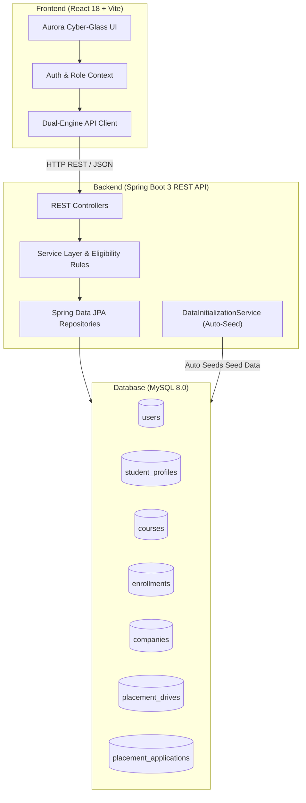
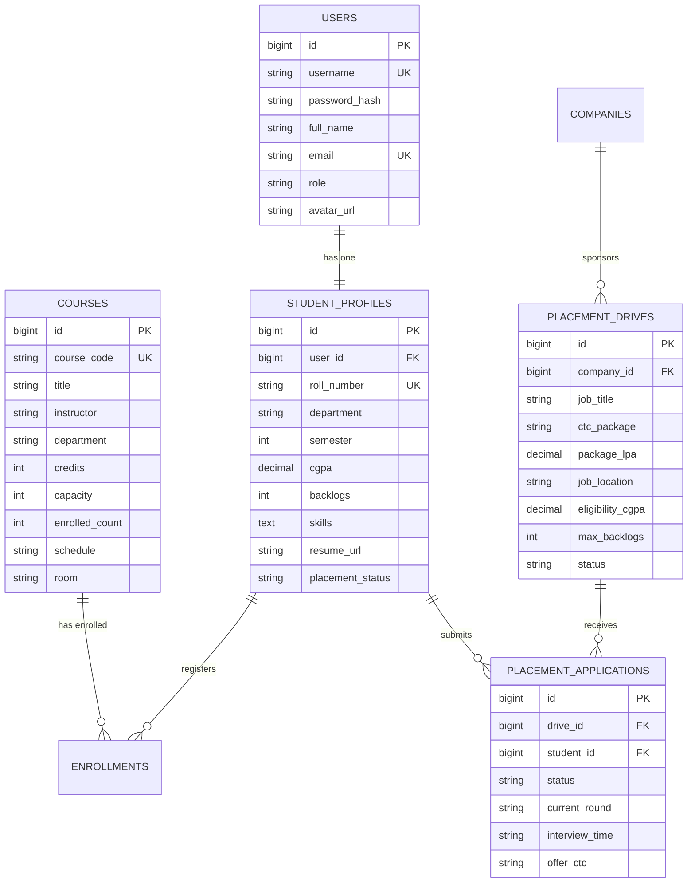

# 🎓 NexCourse & Placement Portal (Full Stack Enterprise Suite)

> An enterprise-grade, full-stack Student Course and Placement Management Portal built with **React JS**, **Spring Boot 3 (Java)**, and **MySQL Database**, presented with a **distinctive Aurora Cyber-Glass UI** design system.

---

## 🌟 Key Highlights & "Different UI" Design

Unlike typical cookie-cutter management dashboards, this portal is crafted with:
- **Aurora Cyber-Glass Aesthetic**: Translucent frosted containers (`backdrop-filter: blur(16px)`), deep obsidian-navy base, and neon accents (Electric Cyan, Violet & Emerald).
- **Interactive Multi-Role Switcher**: 1-click instantaneous switching directly in the top navbar:
  1. 👨‍🎓 **Student View**: Arjun Sharma (CS 7th Sem, 8.85 CGPA) — Enroll in courses, check drive eligibility, view stage progression, manage skills.
  2. 🎯 **Placement Head / Admin**: Dr. K. Ramanathan (T&P Dean) — Department analytics, campus placement statistics, batch metrics.
  3. 🏢 **Recruiter View**: Priya Nandakumar (Campus Hiring Lead @ Google) — Post campus drives, review candidate profiles, schedule interviews, and issue corporate offers.
- **Smart Dual-Mode Engine**: Operates with live Spring Boot REST API (`http://localhost:8080/api`) and features automatic fallback to synchronized local simulation mode if the backend is temporarily offline.
- **Visual Application Stage Pipeline**: Interactive stage progression tracker (`Applied` ➔ `Shortlisted` ➔ `OA Cleared` ➔ `Tech Interview` ➔ `Offered 🎉`).
- **Real-Time Eligibility Engine**: Automatically compares the student's verified CGPA and backlogs with corporate drive requirements before permitting application submission.

---

## 📐 System Architecture



---

## 🗄️ Database Entity Relationship (ER) Diagram



---

## 📂 Project Directory Structure

```
student-placement-portal/
├── backend/                                  # Spring Boot 3 Java application
│   ├── pom.xml                               # Maven dependency configurations
│   ├── src/main/java/com/portal/
│   │   ├── StudentPlacementPortalApplication.java
│   │   ├── config/                           # CORS & Web configs
│   │   ├── controller/                       # REST API controllers
│   │   ├── dto/                              # Request/Response payloads
│   │   ├── entity/                           # JPA Entities (User, StudentProfile, Course, etc.)
│   │   ├── repository/                       # Spring Data JPA interfaces
│   │   └── service/                          # Business logic & auto-initialization
│   └── src/main/resources/
│       └── application.properties            # MySQL and JPA settings
├── frontend/                                 # Modern React + Vite application
│   ├── package.json
│   ├── vite.config.js
│   ├── index.html
│   └── src/
│       ├── index.css                         # Aurora cyber styling & glass tokens
│       ├── api/                              # Dual-engine API client & mock datasets
│       ├── context/                          # Auth & Role switching context
│       ├── components/                       # Navbar, Sidebar, MetricCard, Toast
│       └── pages/                            # Dashboard, Courses, Drives, Applications, Profile, Analytics
├── database/
│   ├── mysql_schema.sql                      # Complete MySQL DDL tables & indexes
│   └── sample_data.sql                       # Rich test records (Google, Microsoft, Amazon, etc.)
├── run-frontend.bat                          # 1-Click launcher for React Web App
├── run-backend.bat                           # 1-Click launcher for Spring Boot Backend
├── setup.bat                                 # Automatic environment setup & build
└── README.md
```

---

## 🚀 Quick Start Guide

### 1. Database Setup (MySQL)
Open MySQL Workbench or your terminal:
```sql
SOURCE C:/Users/gokul/.gemini/antigravity/scratch/student-placement-portal/database/mysql_schema.sql;
SOURCE C:/Users/gokul/.gemini/antigravity/scratch/student-placement-portal/database/sample_data.sql;
```
> *Note: If you run Spring Boot directly, the `DataInitializationService` will also automatically create and seed all sample tables if they are empty!*

### 2. Configure Backend Credentials
Edit `backend/src/main/resources/application.properties` with your MySQL password if needed:
```properties
spring.datasource.url=jdbc:mysql://localhost:3306/student_placement_db?createDatabaseIfNotExist=true&useSSL=false
spring.datasource.username=root
spring.datasource.password=root
```

### 3. Launch the Backend
Open the `backend` folder in IntelliJ IDEA, Eclipse, or VS Code and run `StudentPlacementPortalApplication.java`, or execute:
```powershell
.\run-backend.bat
# Runs REST API at http://localhost:8080/api
```

### 4. Launch the Frontend
Double-click `run-frontend.bat` or run:
```powershell
cd frontend
npm run dev
# Launches in browser at http://localhost:5173
```

---

## 📡 Key REST API Endpoints

| Method | Endpoint | Description |
|---|---|---|
| `GET` | `/api/courses` | Retrieve all academic courses |
| `POST` | `/api/courses` | Create new course (Admin) |
| `POST` | `/api/enrollments/enroll` | Enroll student into a course |
| `DELETE` | `/api/enrollments/drop` | Drop enrolled course |
| `GET` | `/api/enrollments/student/{id}` | Get registered courses for student |
| `GET` | `/api/drives` | Fetch all open placement drives |
| `POST` | `/api/drives` | Create new corporate drive (Recruiter) |
| `POST` | `/api/applications/apply` | Apply for placement drive (with CGPA verification) |
| `GET` | `/api/applications/student/{id}`| Retrieve candidate applications |
| `PUT` | `/api/applications/{id}/status` | Advance candidate stage (Shortlist, Interview, Offer) |
| `GET` | `/api/students/{id}` | Get student academic profile |
| `PUT` | `/api/students/{id}` | Update student skills & portfolio links |
| `GET` | `/api/analytics/dashboard` | Fetch placement statistics and CTC distribution |

---

## 💡 Setting Active Workspace in Antigravity
To open and work on this project directly in Antigravity IDE:
1. Open the File Menu: **File -> Open Folder...**
2. Navigate to and select: `C:\Users\gokul\.gemini\antigravity\scratch\student-placement-portal`
3. Click **Select Folder**.
# student-placement-portal-

